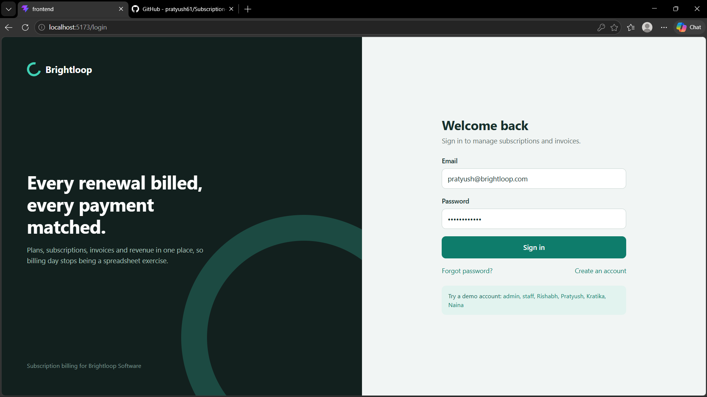
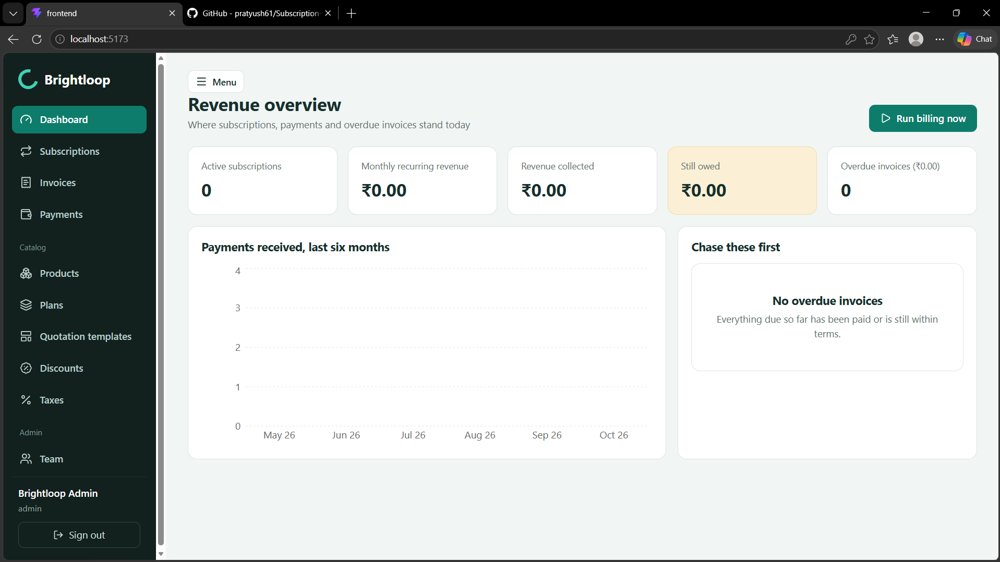
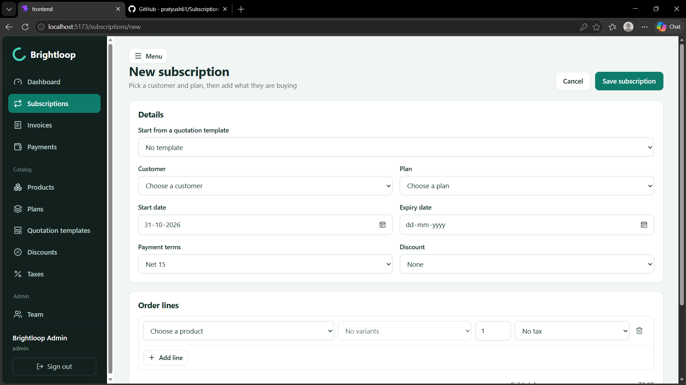
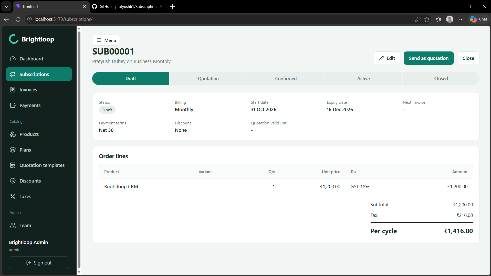
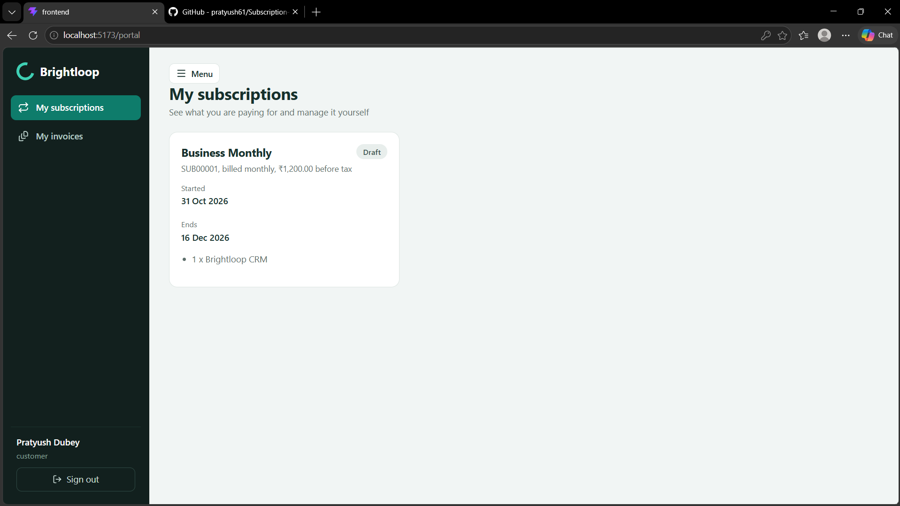
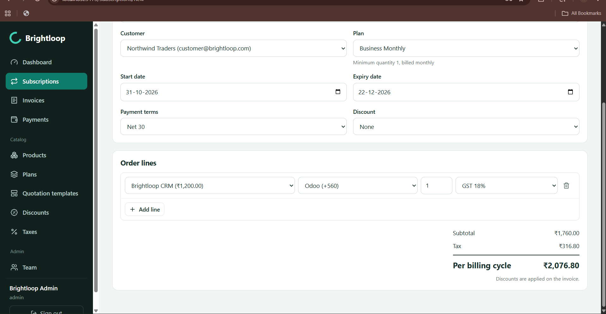
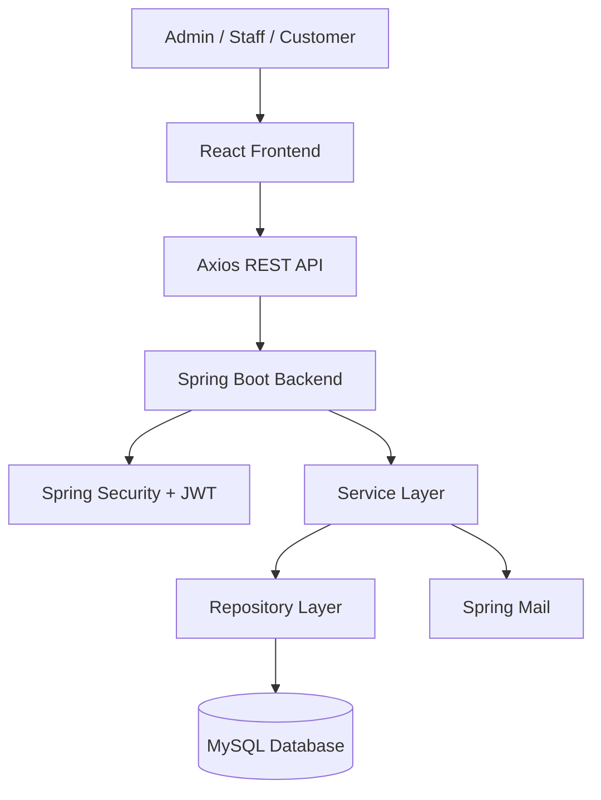
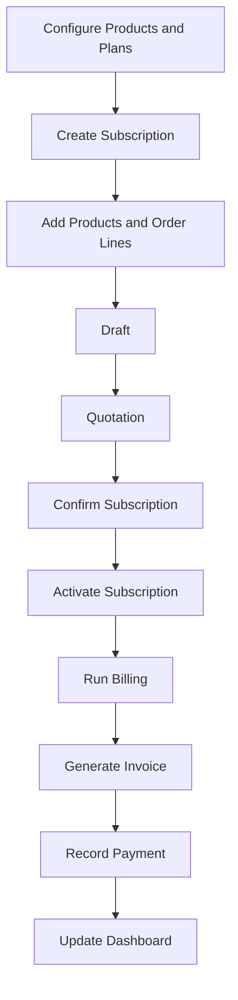

# 🚀 Brightloop – Subscription & Billing Management Platform

> A full-stack SaaS platform for managing subscriptions, recurring billing, invoices, payments, and customers.

## 📌 Project Overview
🚀 Brightloop – Subscription & Billing Management Platform

A full-stack SaaS platform for managing subscriptions, recurring billing, invoices, payments, and customers.

📌 Project Overview

Brightloop is a subscription and billing management platform designed to simplify business operations. It provides a centralized dashboard to manage customers, products, plans, subscriptions, quotations, invoices, taxes, discounts, and payments.

It also provides a dedicated customer portal where customers can view their subscriptions and invoices.

## 🎯 Problem Statement

Businesses often use spreadsheets and disconnected systems to manage subscriptions, renewals, invoices, and payments. This creates manual work, missed billing dates, and poor financial visibility.

## 💡 Our Solution

Brightloop provides an integrated platform that automates subscription workflows, simplifies recurring billing, tracks payments, and gives customers access to their subscription information.

## ✨ Key Features

- JWT authentication and role-based authorization.
- Admin, Staff, and Customer dashboards.
- Subscription creation and lifecycle management.
- Product and subscription plan management.
- Quotation templates.
- Automated recurring billing.
- Invoice generation and management.
- Payment tracking.
- GST and discount management.
- Customer self-service portal.
- Revenue analytics and dashboard reports.
- Email functionality.

---

## 📸 Application Screenshots

### 1. Login Page

Secure login interface with authentication and registration options.



### 2. Admin Dashboard

Revenue overview, active subscriptions, collected revenue, outstanding payments, and overdue invoices.



### 3. Create Subscription

Create subscriptions by selecting customers, plans, products, variants, quantities, and taxes.



### 4. Subscription Details

View subscription information, billing details, order lines, pricing, and lifecycle status.



### 5. Customer Portal

Customers can independently view their subscriptions and access their invoice information.



### 6. Subscription Pricing

Product pricing, variants, quantities, taxes, subtotal, and total billing amount.



---

## 👥 User Roles

| Role | Responsibilities |
|---|---|
| Admin | Complete business and team management |
| Staff | Subscription and billing operations |
| Customer | View personal subscriptions and invoices |

## 🛠️ Technology Stack

**Frontend**
- React.js
- Vite
- JavaScript
- HTML5
- CSS3
- React Router
- Axios
- Recharts

**Backend**
- Java 17
- Spring Boot
- Spring MVC
- Spring Data JPA
- Hibernate
- Spring Security
- JWT Authentication
- Spring Mail

**Database and Tools**
- MySQL
- Maven
- Postman
- Git and GitHub

## 🏗️ System Architecture



## 🔄 Subscription Workflow



## 📂 Project Structure

```text
brightloop/
│
├── backend/
│   ├── src/main/java/com/brightloop/billing/
│   │   ├── config/
│   │   ├── controller/
│   │   ├── dto/
│   │   ├── exception/
│   │   ├── model/
│   │   ├── repository/
│   │   └── service/
│   ├── src/main/resources/
│   └── pom.xml
│
├── frontend/
│   ├── src/
│   │   ├── api/
│   │   ├── components/
│   │   ├── context/
│   │   ├── pages/
│   │   └── utils/
│   └── package.json
│
├── docs/
│   └── screenshots/
│       ├── 01-login.png
│       ├── 02-admin-dashboard.png
│       ├── 03-create-subscription.png
│       ├── 04-subscription-lifecycle.png
│       ├── 05-customer-portal.png
│       └── 06-subscription-pricing.png
│
└── README.md
```

## ⚙️ Installation and Setup

### Prerequisites

- Java JDK 17+
- Node.js and npm
- MySQL
- Maven

### 1. Clone Repository

```bash
git clone YOUR_GITHUB_REPOSITORY_URL
cd brightloop
```

### 2. Create Database

```sql
CREATE DATABASE brightloop;
```

### 3. Configure Backend

Configure your environment variables.

**Windows PowerShell:**

```powershell
$env:DB_USER="root"
$env:DB_PASSWORD="your_mysql_password"
$env:JWT_SECRET="your_long_random_secret"
$env:FRONTEND_URL="http://localhost:5173"
```

For email functionality:

```powershell
$env:MAIL_USER="your_email@gmail.com"
$env:MAIL_PASSWORD="your_gmail_app_password"
```

### 4. Run Backend

```bash
cd backend
mvn spring-boot:run
```

Backend: `http://localhost:8080`

### 5. Run Frontend

Open another terminal:

```bash
cd frontend
npm install
npm run dev
```

Frontend: `http://localhost:5173`

## 🔐 Demo Login Credentials

Brightloop provides six demo accounts to test different user roles and customer experiences.

| Role | Name | Email | Password |
|---|---|---|---|
| Admin | Brightloop Admin | `admin@brightloop.com` | `Admin@12345` |
| Staff | Brightloop Staff | `staff@brightloop.com` | `Staff@12345` |
| Customer | Rishabh Maurya | `rishabh@brightloop.com` | `rishabh@123` |
| Customer | Pratyush Dubey | `pratyush@brightloop.com` | `pratyush@123` |
| Customer | Kratika | `kratika@brightloop.com` | `kratika@123` |
| Customer | Naina | `naina@brightloop.com` | `naina@123` |

### Testing Instructions

1. Open the Brightloop application.
2. Navigate to the login page.
3. Enter any demo account email and password.
4. Click **Sign in**.
5. Explore the features available for that role.

**Note:** Demo accounts are created automatically by the DataSeeder when the database has no existing users. If users already exist, the seeder skips initial account creation.

## 🔗 API Overview

Base URL: `http://localhost:8080/api`

| Module | Main Endpoints |
|---|---|
| Authentication | `/auth/register`, `/auth/login` |
| Products | `/products` |
| Plans | `/plans` |
| Subscriptions | `/subscriptions` |
| Invoices | `/invoices` |
| Payments | `/payments` |
| Taxes | `/taxes` |
| Discounts | `/discounts` |
| Quotations | `/templates` |
| Customer Portal | `/portal/subscriptions`, `/portal/invoices` |
| Billing | `/billing/run` |
| Reports | `/reports/summary` |

Protected APIs require a JWT Bearer token.

## 🗄️ Database and Billing

- MySQL is used as the primary database.
- Hibernate manages database persistence.
- Billing can be triggered manually from the dashboard.
- Scheduled billing runs daily at 2:00 AM.
- Invoices are generated for eligible subscriptions when billing is due.
- Expired subscriptions are handled by the billing service.

## 🔮 Future Enhancements

- Razorpay or Stripe payment gateway integration.
- PDF invoice generation.
- Automated renewal reminders.
- Advanced revenue analytics.
- Subscription churn analysis.
- Docker deployment.
- AWS cloud deployment.
- CI/CD integration.

## 🔒 Security

- JWT-based authentication.
- Password hashing.
- Role-based access control.
- Protected REST APIs.
- Customer-specific data access.
- Environment-based configuration.

Never commit database credentials, email passwords, or production JWT secrets to GitHub.

---

## 🎯 Conclusion

Brightloop brings subscription management, recurring billing, invoice generation, payment tracking, and customer self-service into one platform.

**Brightloop – One platform for subscriptions, billing, invoices, and customer visibility.**
🎯 Problem Statement

Businesses often use spreadsheets and disconnected systems to manage subscriptions, renewals, invoices, and payments. This creates manual work, missed billing dates, and poor financial visibility.

💡 Our Solution

Brightloop provides an integrated platform that automates subscription workflows, simplifies recurring billing, tracks payments, and gives customers access to their subscription information.

✨ Key Features

JWT authentication and role-based authorization.

Admin, Staff, and Customer dashboards.

Subscription creation and lifecycle management.

Product and subscription plan management.

Quotation templates.

Automated recurring billing.

Invoice generation and management.

Payment tracking.

GST and discount management.

Customer self-service portal.

Revenue analytics and dashboard reports.

Email functionality.
